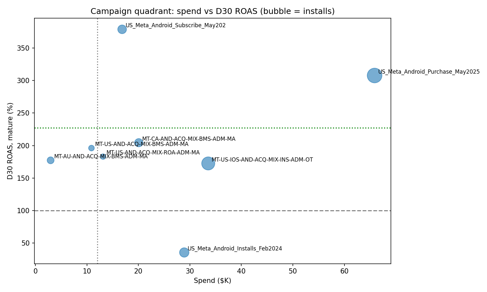
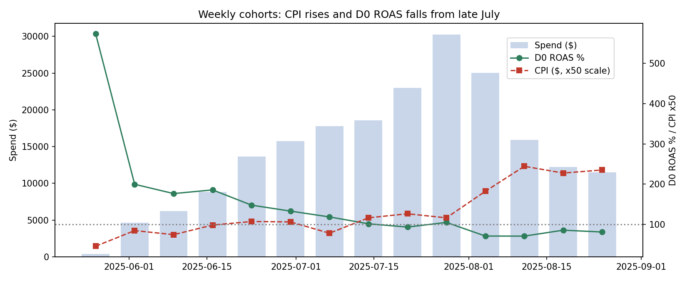
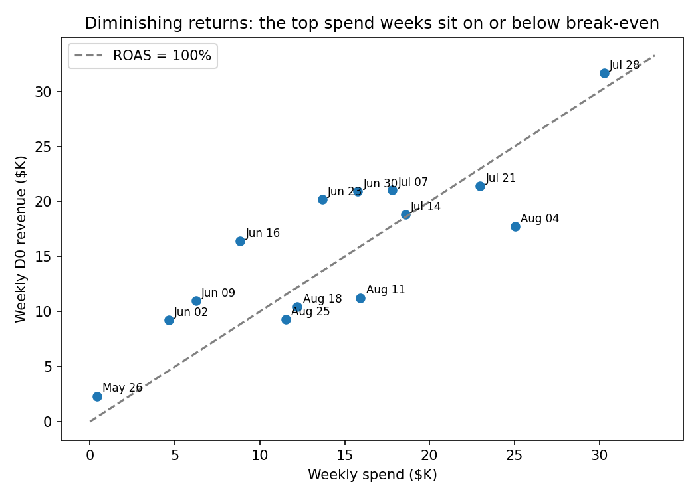
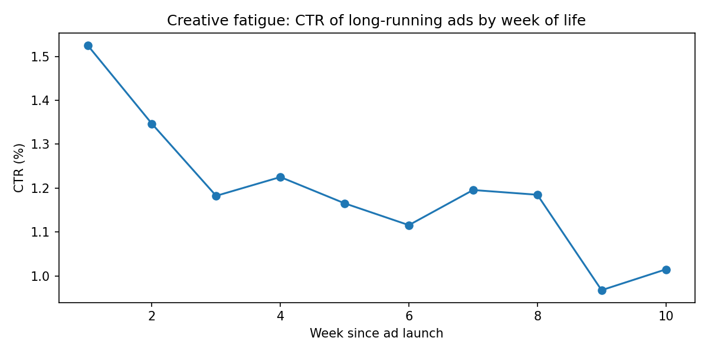

# Growth Review: Meta & Google, Jun 1 – Aug 31, 2025

Dashboard:Dashboard: `dashboard.twbx` (Tableau workbook, opens in free Tableau Public) · Preview: `dashboard.png` / `dashboard.pdf` **Video walkthrough:** [Loom link]
Notebook: `notebook.ipynb` (every step ends with an assertion check)

## TL;DR

- Meta is profitable overall: $203.9K spend, 82.6K installs, $2.47 CPI, 109% D0 ROAS and 227% D30 ROAS on mature cohorts. Spend pays back on install day.
- August broke the economics. CPI rose from $2.07 to $3.93 and D0 ROAS fell from 110% to 78%. Most of the rise (+$1.52 of +$1.86) came from existing campaigns getting more expensive, not from new campaigns.
- Scaling hit diminishing returns. The extra $53.9K spent in July over June returned only 69 cents of D0 revenue per dollar, against a 110% average.
- Google brings volume, not value. Its installs are worth $0.35 of D30 revenue each, against $4.63 on Meta (13x). Google cost data is missing, so its profitability cannot be assessed.

## 1. Data quality and validation

Every source total ties out to the cent after cleaning and merging:

| Metric | Source | Merged | Diff |
|---|---|---|---|
| Meta spend | $203,868.67 | $203,868.67 | 0 |
| Meta clicks | 139,292 | 139,292 | 0 |
| Meta impressions | 11,870,839 | 11,870,839 | 0 |
| Installs (Jun–Aug) | 293,600 | 293,600 | 0 |
| D30 revenue (Jun–Aug) | $469,893.46 | $469,893.46 | 0 |

Data quality log, sorted by impact:

| Source | Issue | Rows | Action |
|---|---|---|---|
| Adjust | spend, clicks, impressions = 0 in all rows | 102,794 | Meta cost from Meta file; Google cost reported as N/A, never 0 |
| Adjust | purchase_revenue = d0_purchase_revenue in all rows | 102,794 | Not used; likely an export mapping error (asked client) |
| Adjust | Rows before Jun 1 (January only; Feb–May missing) | 12,752 | Excluded; comparison window is Jun 1 – Aug 31 |
| Merged | Installs after Aug 1 lack a full 30-day window | 10,948 | `d30_mature` flag; D30 ROAS uses mature cohorts only |
| Adjust | Meta installs outside the campaign's target market | 6,559 | Assigned to campaign market (198 installs, 0.2%) |
| Meta | Campaign 120228257162330689 named both IOS and AND | 797 | Set to iOS using Adjust data for the same campaign ID |
| Adjust | "Expired Attributions", no campaign ID | 229 | Removed (0 installs, $0 revenue) |
| Meta | Country "U.S." | 145 | Standardised to US |
| Adjust | Exact duplicate rows | 33 | Removed |
| Meta | Country "unknown" | 33 | Filled from campaign name ($1.25 spend) |
| Adjust | D30 revenue below D0 | 19 | Kept, flagged as possible refunds |
| Adjust | OS "android-tv" | 2 | Grouped into Android (0 installs) |

Other validation checks:
- Outliers. There are no negative values and no rows with more clicks than impressions. The largest rows (up to $716 spend in a day, or $3.1K of D30 revenue on one row) all belong to the top campaigns on their biggest days, so they were kept as genuine.
- Name changes vs IDs. No ID has more than one name within a file. Across the two files, campaign 120228257162330689 is named `MT-US-IOS-AND-…` in Meta but `MT-US-IOS-ACQ-…` in Adjust, which confirms it is iOS and shows why joins use IDs, not names.
- Flagged, not changed:
  - 2,420 Adjust rows have purchases but 0 installs, and 556 rows have revenue but 0 purchases. Purchases may be counted by event date, while revenue is counted by install cohort. If so, "purchases per install" is approximate.
  - 168 Meta rows have impressions but $0 spend, most likely rounding of very small amounts.

Method.
- Grain: one row per date × network × market × OS × campaign ID.
- Join:both sources were aggregated to that grain first and then full-outer-joined on campaign ID. This means spend is never duplicated (no fan-out), and Google rows are kept.
- Revenue basis: D0 and D30 revenue are install-cohort metrics, so all revenue is attributed to the install date, not the event date.
- Ratios: every ratio is calculated as sum ÷ sum at the level shown, never as an average of ratios.

## 2. Campaign performance

| Campaign | Spend | CPI | Purchases / install | D0 ROAS | D30 ROAS (mature) | Payback | Action |
|---|---|---|---|---|---|---|---|
| US_Meta_Android_Purchase_May2025_Male | $65.9K | $2.49 | 14% | 149% | 308% | Day 0 | Scale carefully |
| MT-US-IOS-AND-…-INS-…_20250707 | $33.6K | $1.63 | 7% | 84% | 173% | < 30 days | Optimise |
| US_Meta_Android_Installs_Feb2024 | $28.9K | $2.98 | 3% | 21% | 36% | > 30 days | Reduce / stop |
| MT-CA-AND-ACQ-MIX-BMS-ADM-MA | $20.1K | $2.86 | 11% | 108% | 204% | Day 0 | Optimise |
| US_Meta_Android_Subscribe_May2025_Male | $16.8K | $2.09 | 16% | 207% | 379% | Day 0 | Scale (paused Jul 7) |
| MT-US-AND-ACQ-MIX-ROA-ADM-MA | $13.1K | $6.29 | 17% | 104% | 183% | Day 0 | Optimise |
| MT-US-AND-ACQ-MIX-BMS-ADM-MA | $10.9K | $4.43 | 14% | 107% | 196% | Day 0 | Optimise (ended Aug 13) |
| MT-AU-AND-ACQ-MIX-BMS-ADM-MA | $3.0K | $0.67 | 3% | 59% | 177% | < 30 days | Optimise (ended Jul 28) |
| 4 August launches (iOS BMS, CA ROA, iOS SPL, CreativeTest) | $11.6K | $5.36–$8.12 | 6–12% | 35–66% | too new | > 30 days so far | Judge after D30 |

Two campaigns share the "Scale" profile, and one of them, Subscribe, was switched off. The Install-optimised campaign is the only one below break-even: on its mature cohorts it spent $23.4K for $8.3K of D30 revenue. It cost $115 per purchase, against $18 on the Purchase campaign.

## 3. Geo and OS

| Segment | Spend | Installs | CPI | D0 ROAS | D30 ROAS (mature) |
|---|---|---|---|---|---|
| United States | $177.3K | 70,508 | $2.51 | 111% | 232% |
| Canada | $23.6K | 7,688 | $3.08 | 98% | 204% |
| Australia | $3.0K | 4,401 | $0.67 | 59% | 177% |
| US Android | $137.0K | 48,943 | $2.80 | 121% | 243% |
| US iOS | $40.3K | 21,565 | $1.87 | 78% | 173% |

- The Android vs iOS comparison has to be read within the US. All iOS spend is in the US, while Android also includes Canada and Australia. Comparing within the US removes that mix effect (a Simpson's paradox check), and the gap holds: iOS users are 33% cheaper to acquire but return 70 points less D30 ROAS. Part of this gap may be SKAdNetwork installs that Adjust cannot attribute.
- Australia was the cheapest market but not the most profitable. It had the lowest CPI ($0.67) but also the lowest purchase rate (3%), and it still returned 177% on D30. It was switched off on Jul 28 at only $3K spend, so it was never tested at scale.

## 4. Purchases and revenue

| Network | Installs | Purchases / install | D0 revenue / purchase | D30 revenue / install (mature) | D30 / D0 multiplier |
|---|---|---|---|---|---|
| Meta | 82,597 | 10.1% | $26.53 | $4.63 | 1.80x |
| Google | 211,003 | 6.9% | $3.47 | $0.35 | 1.68x |

- Google purchases are worth $3.47 each, against $26.53 on Meta. That is consistent with a different product mix: low-price items or trials on Google, subscriptions on Meta. On D30 revenue, Google breaks even only below about $0.35 CPI.
- Revenue roughly doubles between day 0 and day 30. The D30/D0 multiplier is 2.1x on Meta, so D0 ROAS above about 50% already predicts D30 break-even. That makes D0 a usable early guardrail.
- Revenue is concentrated. The top 3 campaigns produce 61% of all D30 revenue, and the Purchase campaign alone produces 37%. That is a dependency risk.

## 5. Cohorts and ROAS

Weekly install cohorts show a steady decline from June onwards. D0 ROAS fell from 199% (week of Jun 2) to 71% (weeks of Aug 4 and Aug 11), while CPI rose from $1.69 to $4.88.

Monthly D30 ROAS on its own is misleading. A naive calculation shows 126% for August, but only 2.5% of August's spend days had a full 30-day window. Months are therefore compared on D0, and D30 is reported only for mature cohorts.

## 6. Hidden insights

Marginal ROAS: scaling hit diminishing returns.

| Month | Spend | D0 ROAS | Marginal D0 ROAS |
|---|---|---|---|
| June | $36.1K | 171% | – |
| July | $90.0K | 110% | 69% (+$53.9K spend → +$37.4K revenue) |
| August | $77.8K | 78% | – (spend fell) |

The same pattern shows inside the Purchase campaign. As its spend went $13.0K → $31.3K → $21.5K, its D0 ROAS went 228% → 144% → 108%. Average ROAS hid that each extra dollar was returning far less than the dollars before it.

Mix vs rate: August was a cost problem, not just a new-campaign problem. CPI rose by $1.86. Holding every continuing campaign at its July CPI explains only +$0.34 (mix). The other +$1.52 (rate) came from the same campaigns getting more expensive: Purchase went $2.17 → $3.99, the iOS install campaign $1.30 → $2.17, and Installs $3.26 → $7.08. The four new August campaigns ($11.6K at $6.43 CPI) made it worse, but they did not cause it.

Creative fatigue. We looked at the 87 ads that ran for 6 weeks or more. Their CTR fell from 1.53% in week 1 to about 1.18% by week 3 and about 1.0% by weeks 9–10, a drop of roughly 30%, while CPM rose from $14.5 to about $17.9. Ads were not refreshed fast enough, which fits the rate effect above. Calendar timing may also contribute to this pattern, since older ads are by definition running later in the summer.

What this data cannot answer.

| Question | Why not | What would answer it |
|---|---|---|
| Retention (D1–D30), funnel drop-off | No event-level data | Adjust event export |
| Revenue concentration by user, whales, payer rate | Data is aggregated; `purchases` counts events, not payers | User-level export |
| Incrementality, Meta–Google cannibalisation | Observational data only | Geo holdout test |
| Attribution bias | Meta's own install counts are not in the file | Meta-reported conversions |
| Google profitability | No cost data | Google Ads cost export |

## 7. Recommendations

1. Move budget from the Install campaign to purchase-optimised campaigns, and scale on marginal ROAS.
   - Pause US_Meta_Android_Installs_Feb2024 (36% D30 ROAS, $115 per purchase).
   - Relaunch the Subscribe campaign (379% D30 ROAS) as a test, after finding out why it was paused on Jul 7.
   - Scale in steps of about 20% a week, and stop when marginal D0 ROAS falls below 50%. That is the D30 break-even level, given the 2.1x D30/D0 multiplier.
   - Estimate: the Install campaign's August budget ($5.9K) would have returned about $5K more D0 revenue at the Purchase campaign's August rate.
2. Refresh creatives every 3 weeks, and add a guardrail for new campaigns.
   - By week 3, CTR is down about a quarter from week 1 while CPM rises. A fixed refresh cadence targets the +$1.52 rate effect directly.
   - Review any new campaign whose D0 ROAS is still below 50% after about 7 days. Three of the four August launches would have been flagged in their first week.
3. Get Google cost data before spending more there. On D30 revenue, Google is only profitable below about $0.35 CPI.

Next experiments:
- a geo holdout to measure Meta incrementality
- an Australia scale test, to see whether its 177% D30 ROAS holds at higher spend

## What I'd double-check with the client

- Is revenue in USD, and is it gross or net of app store fees? If gross, net ROAS is 15–30% lower.
- Is D30 revenue cumulative, i.e. does it include D0?
- Why does purchase_revenue equal d0_purchase_revenue in every row?
- Are purchases counted by event date while revenue is counted by install cohort? 2,420 rows have purchases but no installs.
- Why is February to May missing from Adjust? When was the data exported?
- Do the iOS installs include SKAdNetwork attributions?
- Is Google Ads cost data available?

## Task 4: Predicting high-value users early

I'd first define high-value payers, for example the top 20% of users by D30 revenue, and build features from each user's first 24–72 hours: engagement depth, key funnel events, trial starts and time to first purchase, plus campaign, geo and OS. I'd train a baseline logistic regression and then a gradient-boosted model, validated on a time-based holdout so it reflects how it would perform on new cohorts. The resulting early-value scores could feed value-based bidding on Meta and Google and trigger retention or upsell campaigns for likely payers within days of install.

## Files

- `notebook.ipynb`: the full pipeline
- `cleaned_merged.csv`, `dq_log.csv`, and the charts: outputs
- The raw CSVs are excluded on purpose, as client data may be confidential.

About 5 hours spent. With more time I would fit cohort revenue curves to forecast D30 for August, add confidence intervals to campaign comparisons, and model a spend–response curve for each campaign to set budget caps.

